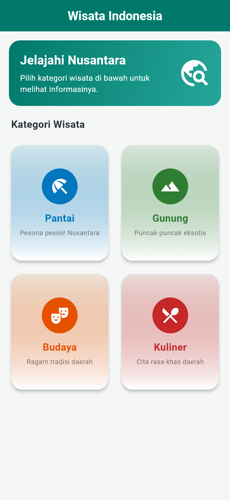
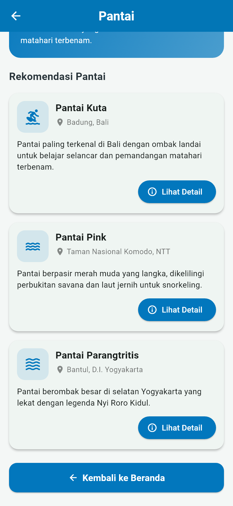
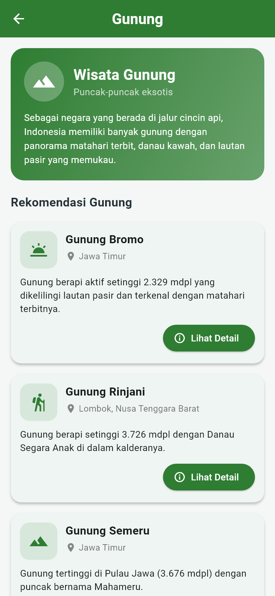
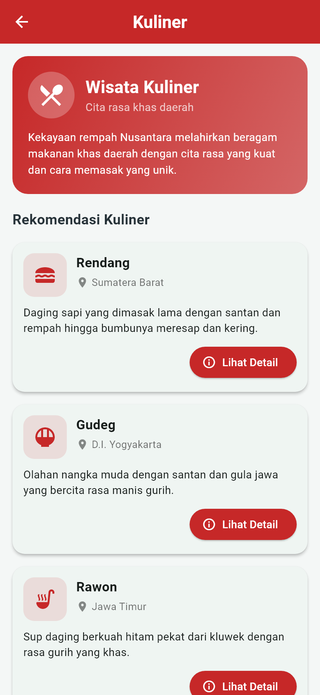
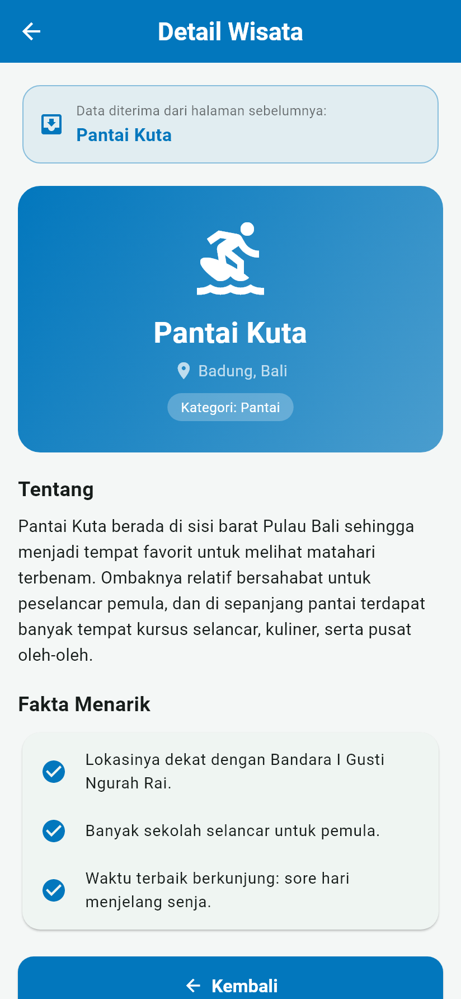
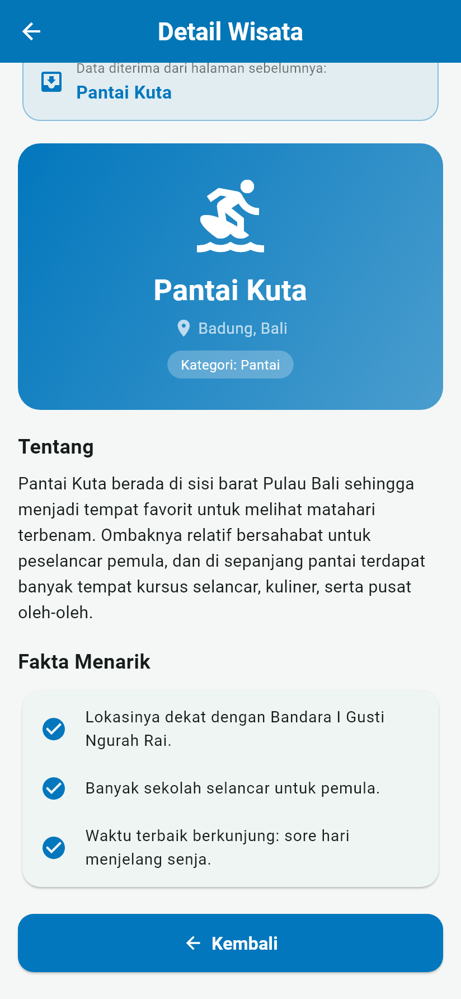
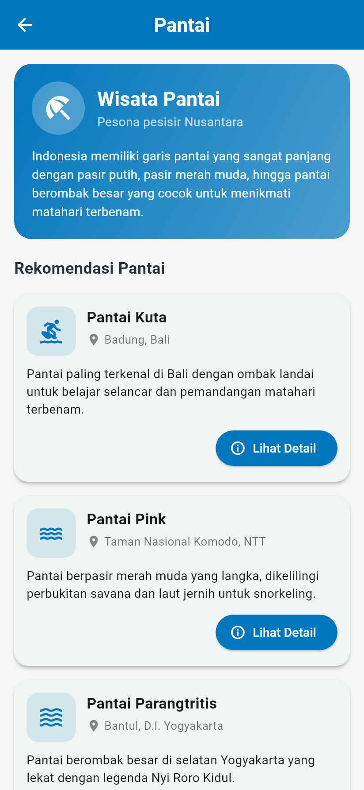

# Wisata Indonesia (navigasi_wisata)

Aplikasi Flutter sederhana bertema **Menu Wisata Indonesia** untuk tugas
**Mobile Programming Bab 7 – Routing dan Navigasi** (Sesi 9).

- **Nama:** Ahmad Mofidur Robbiyal Aqla
- **NIM:** 2495114006
- **Kelas:** 5 - A

## Fitur

- Beranda dengan `Scaffold`, `AppBar` berjudul **"Wisata Indonesia"**, dan
  `GridView.count` dua kolom berisi empat menu (ikon + teks): Pantai, Gunung,
  Budaya, dan Kuliner.
- Empat halaman kategori, masing-masing berisi AppBar, ikon pendukung, teks
  informasi (nama + deskripsi singkat), dan tombol kembali.
- Routing dengan `MaterialApp` → `initialRoute` dan `routes`.
- Navigasi dengan `Navigator.pushNamed()` dan `Navigator.pop()`.
- **Tugas pengembangan:** halaman **Detail Wisata**. Tombol **"Lihat Detail"**
  mengirim nama tempat wisata melalui parameter `arguments`, lalu halaman
  detail membacanya dengan `ModalRoute.of(context)?.settings.arguments`.

## Daftar route

| Nama route | Halaman |
|---|---|
| `/` (initialRoute) | `BerandaPage` |
| `/pantai` | `PantaiPage` |
| `/gunung` | `GunungPage` |
| `/budaya` | `BudayaPage` |
| `/kuliner` | `KulinerPage` |
| `/detail-wisata` | `DetailWisataPage` (menerima `arguments: String`) |

## Struktur folder

```
lib/
├── main.dart                     # MaterialApp, initialRoute, routes
├── routes/app_routes.dart        # konstanta nama route
├── models/wisata.dart            # model KategoriWisata & Wisata
├── data/data_wisata.dart         # isi informasi tiap kategori
├── pages/
│   ├── beranda_page.dart         # GridView.count 2 kolom
│   ├── pantai_page.dart
│   ├── gunung_page.dart
│   ├── budaya_page.dart
│   ├── kuliner_page.dart
│   └── detail_wisata_page.dart   # menerima nama wisata lewat arguments
└── widgets/
    ├── kartu_menu.dart           # kotak menu di beranda
    ├── halaman_kategori.dart     # tata letak halaman kategori + tombol kembali
    └── kartu_wisata.dart         # kartu informasi + tombol "Lihat Detail"
test/widget_test.dart             # 6 pengujian navigasi
```

## Menjalankan

```bash
flutter pub get
flutter run
flutter test
```

## Tampilan

| Beranda | Pantai | Tombol kembali |
|---|---|---|
|  |  |  |

| Gunung | Budaya | Kuliner |
|---|---|---|
|  |  |  |

| Detail Wisata | Detail (bawah) | Kembali dari detail |
|---|---|---|
|  |  |  |

Hasil pengujian: [screenshots/11_hasil_pengujian.png](screenshots/11_hasil_pengujian.png)

## Dokumen tugas

- Video demonstrasi (± 3 menit): [video/demo_navigasi_wisata.mp4](video/demo_navigasi_wisata.mp4)
- Laporan + jawaban pertanyaan evaluasi (PDF): [laporan/Laporan_Bab7_Routing_Navigasi_Flutter_Ahmad_Mofidur_Robbiyal_Aqla.pdf](laporan/Laporan_Bab7_Routing_Navigasi_Flutter_Ahmad_Mofidur_Robbiyal_Aqla.pdf)
- Laporan (Word): [laporan/Laporan_Bab7_Routing_Navigasi_Flutter_Ahmad_Mofidur_Robbiyal_Aqla.docx](laporan/Laporan_Bab7_Routing_Navigasi_Flutter_Ahmad_Mofidur_Robbiyal_Aqla.docx)
